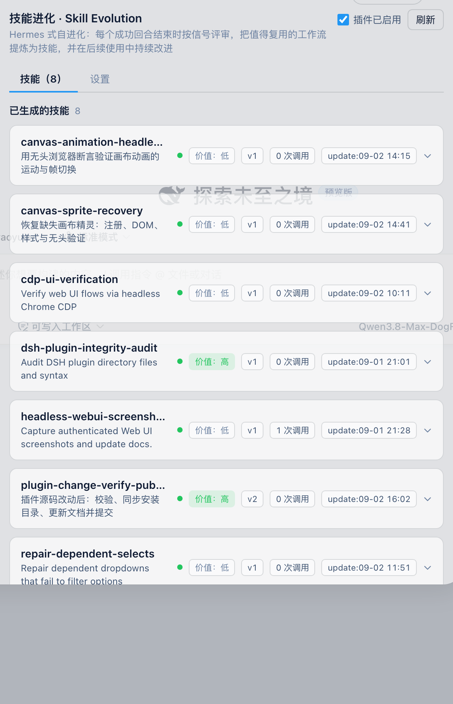
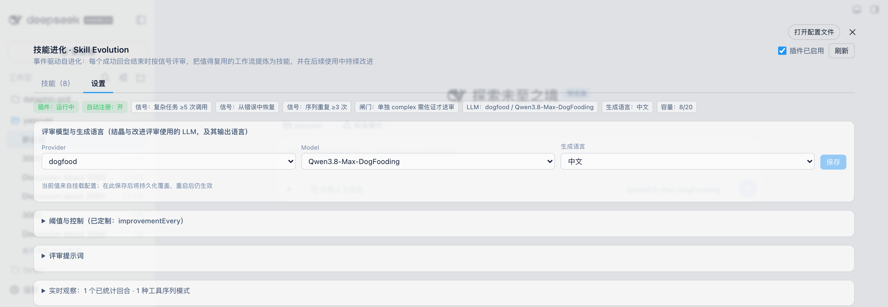
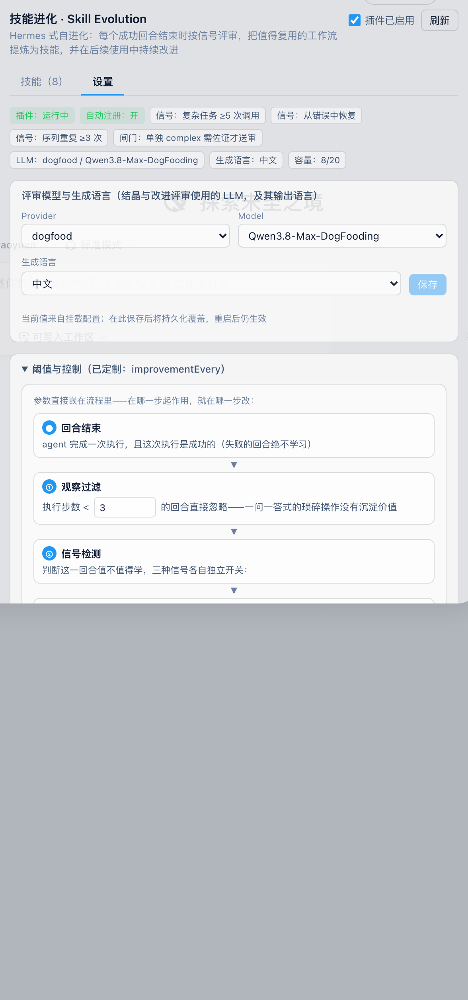

# dsh-skill-evolution

[English](#english) | 中文

DeepSeek Harness（DSH）的**技能自进化插件**：观察 agent 执行轨迹，在每个成功回合结束时按信号触发 LLM 评审，把值得复用的工作流**结晶为技能**并注册进技能目录；后续同类执行还会把新经验合并进已有技能。插件自带设置页管理面板，技能持久化、重启不丢。

结晶采用**事件驱动评审**（回合结束时按信号送审），而非纯频率统计。

## 工作原理

**事件驱动**：每个回合结束（`turn/end`）时，对满足最小步数的成功轨迹检测三个信号，任一信号触发即送 LLM 评审：

| 信号 | 条件 | 含义 |
|---|---|---|
| `complex` | 成功回合且工具调用 ≥ `minToolCalls`（默认 5） | 完成了一件复杂任务 |
| `recovered` | 有失败步骤但回合最终成功（找到了绕行路径） | 踩坑后找到了可行的绕行路径 |
| `repeated` | 同一工具序列出现 ≥ `minPatternOccurrences` 次且成功率 ≥ `minSuccessRate` | 同一套操作反复出现且成熟可靠 |

**单独 complex 闸门**（`complexRequiresCorroboration`，默认开）：`complex` 单独触发是弱证据（任何长回合都满足），默认必须叠加 `recovered` 或 `repeated` 佐证才送评审；被拦下的回合会在日志里记一条 withheld，等序列后续出现佐证信号时再送审。设为 `false` 恢复原"任一信号即送审"行为。

**评审门禁**（事件驱动 background-review）：评审 LLM 收到完整证据（信号、用户意图、工具序列、每步成败与摘要）与**已有进化技能清单**，决定 `SAVE`、`FOLD_INTO` 或 `NOTHING_TO_SAVE`。硬性负面清单——以下内容**绝不结晶**：

- 环境性失败（缺二进制、未配置凭证、未装包）
- 对工具的负面断言（"X 工具坏了"会固化成长期拒绝）
- 重试即愈的瞬时错误（教训是重试模式，不是原错误）
- 一次性任务叙事、未解决的失败

**渐进改进**（技能是活的）：当新证据落在已有进化技能的序列上（尤其是错误恢复经验），评审会把新教训合并进已有技能内容并版本 +1，而不是创建重复技能。

**语义去重**（FOLD_INTO）：同一类经验可能经由**不同的工具序列**再次出现——纯序列匹配拦不住这种重复。因此结晶评审会把已有技能清单（名字+描述）一并交给评审 LLM；若判定新证据与某个已有技能属于同一工作流类别，评审输出 `VERDICT: FOLD_INTO: <已有技能名>`，宿主随即用本次证据走改进管道并入该技能（版本 +1），而不是新建近重复技能。目标技能不存在时按放弃处理并记日志。

**产出格式**：类级命名的 kebab-case 技能，标准 SKILL.md 结构（`# Title / ## When to Use / ## Procedure / ## Pitfalls / ## Verification`）。

## 组成

双面插件包（host + web client）：

| 文件 | 角色 |
|---|---|
| `plugin.mjs` | 宿主半：轨迹观察、信号检测、LLM 评审、技能注册、`./generated/` 持久化、`/skill-evolution` 认证 RPC 通道 |
| `client.js` | 浏览器半：设置页「技能进化」分区（技能卡片、信号展示、两步确认删除/清空、实时模式统计） |
| `cordis.patch.yml` | `dsh.bundle.patch` 挂载层 |

仅依赖 `node:` 内建模块，不引入任何 `@deepseek-ai` 包，避免与宿主 cordis 双实例冲突。

## 安装

### 方式一：官方 CLI（发布到 npm 后）

```bash
dsh plugin --profile web add dsh-skill-evolution
```

包内 `dsh.bundle.patch` 会自动挂载，无需手改 profile 文件。

### 方式二：git clone + link

```bash
git clone https://github.com/VanadisGithub/dsh-skill-evolution.git ~/Code/dsh-skill-evolution
```

在 `~/.dsh/profiles/web/package.json` 的 `dependencies` 中加入：

```json
"dsh-skill-evolution": "link:/Users/<you>/Code/dsh-skill-evolution"
```

然后在 `~/.dsh/profiles/web` 执行 `pnpm install`，硬刷新浏览器。

### 方式三：file:// 手动挂载（原型调试）

把仓库放到任意目录（如 `~/.dsh/plugins/skill-evolution/`），在 `~/.dsh/cordis.patch.yml` 追加：

```yaml
- insert:
  - id: 'skill-evolution'
    name: file:///Users/<you>/.dsh/plugins/skill-evolution/plugin.mjs?v=1
    config:
      minToolCalls: 5
      minPatternOccurrences: 3
      autoRegister: true
      llmProvider: deepseek      # 按你的部署可用的 provider 修改
      llmModel: deepseek-chat
```

`?v=N` 用于绕过 Node 模块缓存；改了 `plugin.mjs` 就 +1。宿主半改动需 loader 重放补丁，浏览器半改动硬刷新即可。

> ⚠️ 三种方式只能选一种，重复挂载会导致双实例。

## 配置

下表所有键都**既走挂载配置，也可在设置面板里直接修改**（面板改动持久化到插件目录 `runtime-config.json`，优先于挂载配置，重启后仍生效）。

| 键 | 默认 | 说明 |
|---|---|---|
| `minTraceSteps` | `3` | 轨迹最小步数（噪音地板） |
| `minToolCalls` | `5` | `complex` 信号阈值 |
| `minPatternOccurrences` | `3` | `repeated` 信号阈值 |
| `minSuccessRate` | `0.7` | `repeated` 信号成功率下限 |
| `signals` | 全开 | `{complex, recovered, repeated}` 分别开关 |
| `complexRequiresCorroboration` | `true` | 单独 `complex` 信号需叠加 `recovered`/`repeated` 佐证才送评审 |
| `autoRegister` | `true` | 结晶后自动注册进技能目录 |
| `llmProvider` / `llmModel` | `deepseek` / `deepseek-chat` | 评审用的模型（必须是部署中存在的 provider） |
| `skillLanguage` | `en` | 生成技能的语言：`zh`（中文）或 `en`（英文）。NAME 与 SKILL.md 章节标题恒为英文，正文与 DESCRIPTION 跟随该语言 |
| `enabled` | `true` | 总开关：`false` 时不观察回合、不评审结晶（已有技能保持注册）。**也可直接在设置面板右上角切换** |
| `maxEvolvedSkills` | `20` | 进化技能容量上限 |
| `improvementEvery` | `3` | 每 N 次同序列重跑触发一次改进评审 |
| `maxImprovementsPerProcess` | `5` | 每进程每技能改进次数上限 |
| `maxEvidenceSteps` | `30` | 送评审的最大步骤数 |
| `maxStepTextLength` | `200` | 每步参数/结果摘要截断长度 |
| `maxTracesPerSession` | `50` | 每会话保留的轨迹条数 |

结晶与改进评审的**系统提示词**同样可在面板里自定义（见下），不属于挂载配置键。

### 在 UI 里改评审模型

设置 → 技能进化 面板内置**评审模型**编辑器：Provider 下拉列出本部署所有已注册的 LLM provider（来自 `ctx.llm.listProviders()`），Model 下拉跟随所选 provider 的模型目录（`ctx.llm.listModels(provider)`）级联刷新，切换 provider 会自动落到该目录的首个模型；目录是 advisory 的，末尾的「手动输入 model id…」可切回自由输入填目录外模型。保存后立即生效，并持久化到插件目录的 `runtime-config.json`（优先于挂载配置，重启后仍生效）；「恢复默认」按钮回落到挂载配置的 `llmProvider`/`llmModel`，其余运行时覆盖（语言、阈值、提示词）原样保留。

同一行还有**生成语言**下拉（中文 / English）：改动即存，下次结晶与改进评审立刻按该语言输出，同样持久化在 `runtime-config.json`。它只影响**新生成和新改进**的技能，已结晶的技能不会被追溯改写。

### 在 UI 里改阈值与提示词

**阈值与控制**面板：上表全部数值阈值（输入框带合法区间）加五个开关（三个信号、complex 佐证闸门、自动注册）。草稿-保存模式——「保存改动」只提交实际改动的键并立即生效，「放弃改动」回到当前生效值，「恢复默认」一键回到挂载配置基线。面板标题会标出已定制的键。

**评审提示词**面板：结晶评审与改进评审两段系统提示词，textarea 编辑、保存即生效；语言指令由服务端按「生成语言」自动追加，自定义提示词里无需重复声明。留空保存即恢复内置默认。

所有 UI 覆盖统一持久化在 `runtime-config.json`（单一写入器：仍存在的覆盖保留，全部清空时删除文件），重启自动恢复。

不想用 UI 也可以走配置层：在 `~/.dsh/profiles/<profile>/cordis.patch.yml`（或 `~/.dsh/cordis.patch.yml`）追加一条覆盖行——不带 `insert`、按 `id` 命中已挂载条目：

```yaml
- id: 'skill-evolution'
  config:
    llmProvider: <your-provider>
    llmModel: <your-model>
    skillLanguage: zh        # or en
```

注意 `config` 是**整体替换**而非合并，需要保留的键请一并写全。

## 管理面板

设置 → **技能进化**，两个 tab：

**技能** tab：

- 技能卡片：**价值**（高/中/低——按出现次数、改进次数与版本估算）、**版本**、**调用次数**（agent 调用宿主 `skill` 工具加载，或用户直接触发注入，两条路径都计数）、**更新时间**；展开查看结晶信号、工具序列与完整 SKILL.md
- 单个删除 / 清空全部（均为两步确认）；删除会同时反注册并删除磁盘文件

**设置** tab：

- 配置与信号开关一览、实时模式统计（各序列出现次数/成功率/是否结晶）
- **评审模型编辑器**：改 provider/model、保存持久化、一键恢复默认
- **生成语言下拉**：中文 / English，改动即存并持久化，下次评审即生效
- **阈值与控制**：一张**可编辑的流程图**——回合结束 → ① 观察过滤 → ② 信号检测 → ③ 佐证闸门 → ④ LLM 评审 → ⑤ 结晶入库 → ⑥ 持续改进（↺ 循环回 ④）；每个参数的输入框/开关**直接嵌在它起作用的流程句子里**（如"工具调用数 ≥ [6]"），边看流程边改；草稿-保存，一键恢复默认；内部观察参数（`maxEvidenceSteps` 等）不在 UI 里，走挂载配置
- **评审提示词**：结晶与改进两段系统提示词可自定义，留空保存即恢复内置默认

**总开关**（分区右上角）：停用后不再观察回合、不再评审结晶；已生成的技能保持注册可用。状态持久化，重启后保持。

## 截图 / Screenshots

**技能** tab——技能卡片带价值（高/中/低）、版本、调用次数与更新时间标签，展开查看结晶信号、工具序列与完整 SKILL.md：



**设置** tab——状态一览、评审模型、生成语言与各配置面板：



**阈值与控制**——参数直接嵌在流程图里，在哪一步起作用就在哪一步改：



宿主侧另暴露认证 RPC 通道 `/skill-evolution`：`list` / `get` / `remove` / `clear`。

## 数据与隐私

- 进化技能持久化在插件目录 `generated/<name>.json`（原子写入），服务重启自动恢复注册
- 轨迹统计仅在本进程内存，重启重新累计
- 评审调用走 DSH 自身的 LLM 通道；证据只包含工具名、截断后的参数/结果摘要（默认 ≤200 字符）与首条用户消息

## English

Event-driven skill self-evolution plugin for DeepSeek Harness (DSH). It watches agent execution traces and, at the end of every successful turn, fires an LLM review when any signal trips — a **complex** turn (≥5 tool calls), a **recovered** turn (failed steps but a working path found), or a **repeated** tool sequence. By default a lone `complex` signal must be corroborated by `recovered` or `repeated` before review (`complexRequiresCorroboration`, configurable). The reviewer either crystallizes a class-level reusable skill (registered into the skill catalog and persisted under `generated/`) or answers `NOTHING_TO_SAVE`, following a hard do-not-capture list (environment failures, negative tool claims, transient errors, one-off narratives, unresolved failures). Existing evolved skills are progressively improved with fresh evidence instead of duplicated. Ships a Settings-section management UI (view / expand / delete / clear) backed by an authenticated `/skill-evolution` RPC channel. Host half uses `node:` builtins only.

Install: `dsh plugin --profile web add dsh-skill-evolution` (npm), or `link:` / `file://` mounts — see the Chinese section above for details.

## License

[MIT](./LICENSE)
