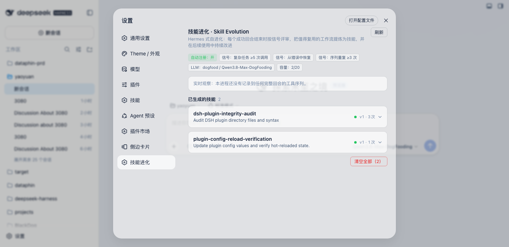
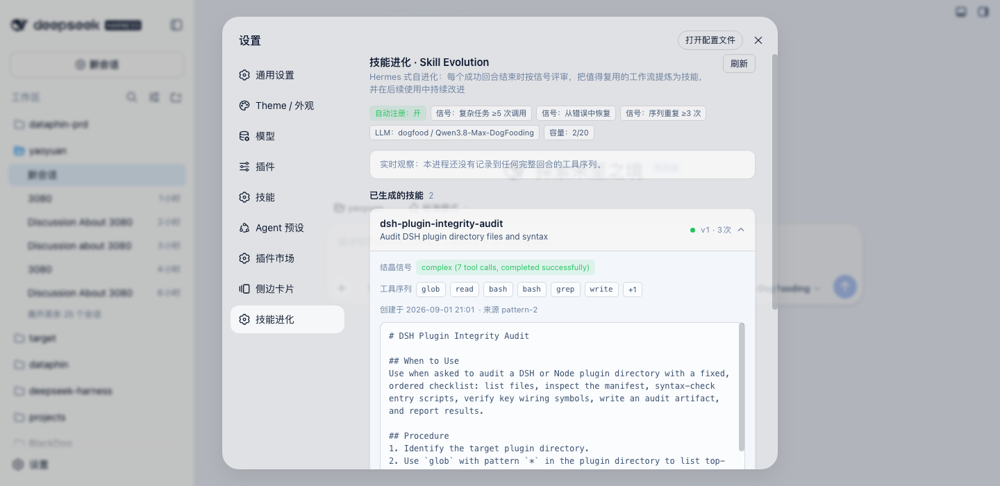

# dsh-skill-evolution

[English](#english) | 中文

DeepSeek Harness（DSH）的 **Hermes 式技能自进化插件**：观察 agent 执行轨迹，在每个成功回合结束时按信号触发 LLM 评审，把值得复用的工作流**结晶为技能**并注册进技能目录；后续同类执行还会把新经验合并进已有技能。插件自带设置页管理面板，技能持久化、重启不丢。

结晶模型参考 [Nous Research Hermes Agent](https://hermes-agent.nousresearch.com/docs/user-guide/features/skills) 的自进化机制（事件驱动评审，而非纯频率统计）。

## 工作原理

**事件驱动**：每个回合结束（`turn/end`）时，对满足最小步数的成功轨迹检测三个信号，任一信号触发即送 LLM 评审：

| 信号 | 条件 | 对应 Hermes 触发条件 |
|---|---|---|
| `complex` | 成功回合且工具调用 ≥ `minToolCalls`（默认 5） | "completed a complex task (5+ tool calls) successfully" |
| `recovered` | 有失败步骤但回合最终成功（找到了绕行路径） | "hit errors or dead ends and found the working path" |
| `repeated` | 同一工具序列出现 ≥ `minPatternOccurrences` 次且成功率 ≥ `minSuccessRate` | 重复轨迹学习（GEPA 式） |

**评审门禁**（Hermes background-review 模型）：评审 LLM 收到完整证据（信号、用户意图、工具序列、每步成败与摘要），决定 `SAVE` 或 `NOTHING_TO_SAVE`。硬性负面清单——以下内容**绝不结晶**：

- 环境性失败（缺二进制、未配置凭证、未装包）
- 对工具的负面断言（"X 工具坏了"会固化成长期拒绝）
- 重试即愈的瞬时错误（教训是重试模式，不是原错误）
- 一次性任务叙事、未解决的失败

**渐进改进**（技能是活的）：当新证据落在已有进化技能的序列上（尤其是错误恢复经验），评审会把新教训合并进已有技能内容并版本 +1，而不是创建重复技能。

**产出格式**：类级命名的 kebab-case 技能，标准 SKILL.md 结构（`# Title / ## When to Use / ## Procedure / ## Pitfalls / ## Verification`）。

## 组成

双面插件包（host + web client）：

| 文件 | 角色 |
|---|---|
| `plugin.mjs` | 宿主半：轨迹观察、信号检测、LLM 评审、技能注册、`./generated/` 持久化、`/skill-evolution` 认证 RPC 通道 |
| `client.js` | 浏览器半：设置页「技能进化」分区（技能卡片、信号展示、两步确认删除/清空、实时模式统计） |
| `cordis.patch.yml` | `dsh.bundle.patch` 挂载层 |

仅依赖 `node:` 内建模块，不引入任何 `@deepseek-ai` 包，避免与宿主 cordis 双实例冲突。

## 安装

### 方式一：官方 CLI（发布到 npm 后）

```bash
dsh plugin --profile web add dsh-skill-evolution
```

包内 `dsh.bundle.patch` 会自动挂载，无需手改 profile 文件。

### 方式二：git clone + link

```bash
git clone https://github.com/VanadisGithub/dsh-skill-evolution.git ~/Code/dsh-skill-evolution
```

在 `~/.dsh/profiles/web/package.json` 的 `dependencies` 中加入：

```json
"dsh-skill-evolution": "link:/Users/<you>/Code/dsh-skill-evolution"
```

然后在 `~/.dsh/profiles/web` 执行 `pnpm install`，硬刷新浏览器。

### 方式三：file:// 手动挂载（原型调试）

把仓库放到任意目录（如 `~/.dsh/plugins/skill-evolution/`），在 `~/.dsh/cordis.patch.yml` 追加：

```yaml
- insert:
  - id: 'skill-evolution'
    name: file:///Users/<you>/.dsh/plugins/skill-evolution/plugin.mjs?v=1
    config:
      minToolCalls: 5
      minPatternOccurrences: 3
      autoRegister: true
      llmProvider: deepseek      # 按你的部署可用的 provider 修改
      llmModel: deepseek-chat
```

`?v=N` 用于绕过 Node 模块缓存；改了 `plugin.mjs` 就 +1。宿主半改动需 loader 重放补丁，浏览器半改动硬刷新即可。

> ⚠️ 三种方式只能选一种，重复挂载会导致双实例。

## 配置

| 键 | 默认 | 说明 |
|---|---|---|
| `minTraceSteps` | `3` | 轨迹最小步数（噪音地板） |
| `minToolCalls` | `5` | `complex` 信号阈值 |
| `minPatternOccurrences` | `3` | `repeated` 信号阈值 |
| `minSuccessRate` | `0.7` | `repeated` 信号成功率下限 |
| `signals` | 全开 | `{complex, recovered, repeated}` 分别开关 |
| `autoRegister` | `true` | 结晶后自动注册进技能目录 |
| `llmProvider` / `llmModel` | `deepseek` / `deepseek-chat` | 评审用的模型（必须是部署中存在的 provider） |
| `maxEvolvedSkills` | `20` | 进化技能容量上限 |
| `improvementEvery` | `3` | 每 N 次同序列重跑触发一次改进评审 |
| `maxImprovementsPerProcess` | `5` | 每进程每技能改进次数上限 |
| `maxEvidenceSteps` | `30` | 送评审的最大步骤数 |

## 管理面板

设置 → **技能进化**：

- 配置与信号开关一览、实时模式统计（各序列出现次数/成功率/是否结晶）
- 技能卡片：结晶信号、工具序列、版本与改进次数；展开查看完整 SKILL.md
- 单个删除 / 清空全部（均为两步确认）；删除会同时反注册并删除磁盘文件

## 截图 / Screenshots

设置页「技能进化」总览——信号配置、实时模式统计与已结晶技能卡片：



展开技能卡片——结晶信号、工具序列与完整 SKILL.md 内容：



宿主侧另暴露认证 RPC 通道 `/skill-evolution`：`list` / `get` / `remove` / `clear`。

## 数据与隐私

- 进化技能持久化在插件目录 `generated/<name>.json`（原子写入），服务重启自动恢复注册
- 轨迹统计仅在本进程内存，重启重新累计
- 评审调用走 DSH 自身的 LLM 通道；证据只包含工具名、截断后的参数/结果摘要（默认 ≤200 字符）与首条用户消息

## English

Hermes-style skill self-evolution plugin for DeepSeek Harness (DSH). It watches agent execution traces and, at the end of every successful turn, fires an LLM review when any signal trips — a **complex** turn (≥5 tool calls), a **recovered** turn (failed steps but a working path found), or a **repeated** tool sequence. The reviewer either crystallizes a class-level reusable skill (registered into the skill catalog and persisted under `generated/`) or answers `NOTHING_TO_SAVE`, following Hermes' do-not-capture rules (environment failures, negative tool claims, transient errors, one-off narratives, unresolved failures). Existing evolved skills are progressively improved with fresh evidence instead of duplicated. Ships a Settings-section management UI (view / expand / delete / clear) backed by an authenticated `/skill-evolution` RPC channel. Host half uses `node:` builtins only.

Install: `dsh plugin --profile web add dsh-skill-evolution` (npm), or `link:` / `file://` mounts — see the Chinese section above for details.

## License

[MIT](./LICENSE)
